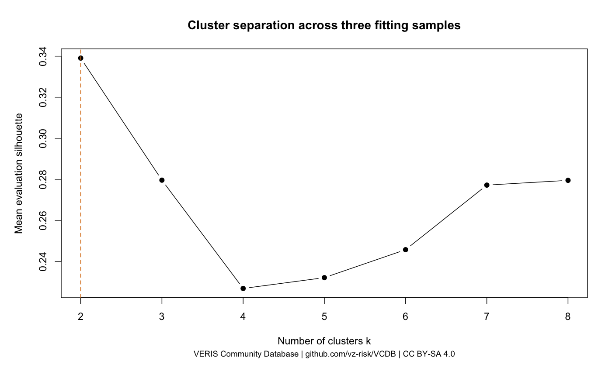
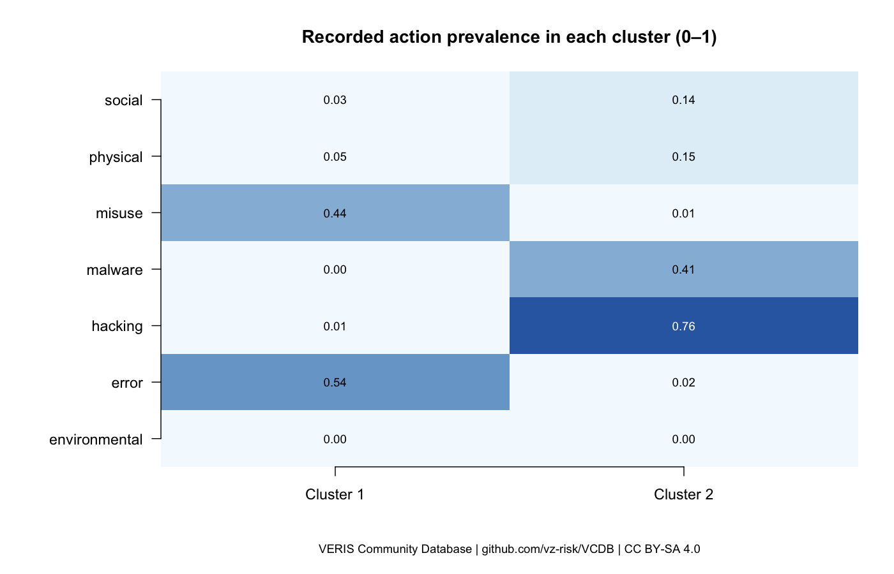

# open-base-search

## Анализ и кластеризация инцидентов утечки данных для оценки применимости блокчейн-технологий в защите информации

**Групповая исследовательская работа по дисциплине «Блокчейн»**  
**Выполнили:** Айдар Н., Бычков Н., Карим Д.  
**Группа:** СИБ-23-5

> Проект исследует публичные описания инцидентов, выделяет группы похожих сценариев и оценивает возможности технологий проверки целостности истории. Результат включает код Python и R, подготовленные данные, визуальный отчёт и учебный эксперимент с хеш-цепочкой.

## Аннотация

В работе исследуются структурированные сведения об инцидентах информационной безопасности из VERIS Community Database (VCDB). Исходный снимок содержит 10 047 карточек. После отбора подтверждённых раскрытий данных и исключения коллизий идентификаторов сформирована основная выборка из 6 911 карточек. Для кластеризации использованы 5 347 карточек с содержательными значениями во всех четырёх семействах признаков: действия, участники, активы и данные.

Проведена кластеризация методом PAM на подвыборках с равновзвешенным расстоянием Жаккара по семействам признаков. Выбрано разбиение на две группы: преимущественно внутренние сценарии и преимущественно внешние атаки. Средний silhouette составил 0,339, средний ARI между запусками — 0,868. Проверка чувствительности выявила существенную зависимость разбиения от признаков типа участника.

Вторая часть работы включает качественное сравнение архитектур хранения и аудита, а также воспроизводимый эксперимент с изменением журнала. Показано, что внутренняя согласованность хеш-цепочки не исключает полного переписывания истории; для выявления такой подмены необходима заранее сохранённая доверенная контрольная отметка. Обоснован возможный сценарий применения блокчейна: совместное ведение проверяемой истории несколькими независимыми организациями. Эффективность блокчейна в предотвращении утечек в работе не измерялась.

**Ключевые слова:** утечки данных, VCDB, VERIS, кластеризация, PAM, расстояние Жаккара, аудит, целостность, блокчейн, воспроизводимость.

## Содержание

1. [Проблема и актуальность](#1-проблема-и-актуальность)
2. [Цель, объект и задачи](#2-цель-объект-и-задачи)
3. [Исследовательские вопросы](#3-исследовательские-вопросы)
4. [Данные и формирование выборки](#4-данные-и-формирование-выборки)
5. [Методология](#5-методология)
6. [Результаты анализа](#6-результаты-анализа)
7. [Оценка применимости блокчейна](#7-оценка-применимости-блокчейна)
8. [Эксперимент с целостностью журнала](#8-эксперимент-с-целостностью-журнала)
9. [Ограничения исследования](#9-ограничения-исследования)
10. [Практическая значимость и выводы](#10-практическая-значимость-и-выводы)
11. [Быстрый запуск](#быстрый-запуск)
12. [Источники исследования](#источники-исследования)

## 1. Проблема и актуальность

Публичные сообщения об утечках различаются по структуре и полноте: одни описывают действия нарушителя, другие — затронутые системы или объём раскрытых записей. Пропуски, неодинаковая детализация и особенности публикации затрудняют сравнение случаев. Отдельное сообщение также не позволяет судить о распространённости сценария во всей совокупности организаций.

Практическая проблема проекта состоит в том, чтобы превратить разнородные описания в проверяемый набор данных, выявить повторяющиеся сочетания характеристик и обозначить направления защиты, которые требуют дальнейшей проверки.

Для дисциплины «Блокчейн» дополнительно важен вопрос выбора архитектуры. Проверяемость истории изменений, конфиденциальность содержимого и предотвращение несанкционированного доступа — разные задачи. Наличие блокчейна само по себе не означает, что все эти задачи решены. Поэтому в исследовании сопоставляются конкретные свойства технологий и предпосылки доверия.

## 2. Цель, объект и задачи

**Цель исследования:** выявить группы сходных публично описанных инцидентов и оценить условия применения блокчейн-технологий для контроля целостности и совместного аудита информации.

**Объект исследования:** карточки публично описанных инцидентов утечки данных в VCDB.

**Предмет исследования:** сходство зарегистрированных характеристик инцидентов, устойчивость их группировки и свойства архитектур, обеспечивающих проверяемость истории действий.

**Задачи исследования:**

1. Зафиксировать версию открытого источника и выполнить воспроизводимое преобразование данных.
2. Проанализировать пропуски, коллизии идентификаторов и статусы качества.
3. Сформировать признаки без выдуманного заполнения неизвестных значений.
4. Сравнить разбиения с различным числом кластеров и проверить устойчивость.
5. Интерпретировать профили групп с учётом смещения отбора.
6. Сопоставить базу данных, хеш-цепочку, цифровую подпись и блокчейн с ограниченным кругом участников.
7. Проверить обнаружение нескольких видов подмены журнала на синтетических событиях.
8. Представить результаты в автоматически формируемом отчёте и материалах для защиты.

## 3. Исследовательские вопросы

| Вопрос | Способ исследования | Что можно установить |
|---|---|---|
| Какие группы похожих инцидентов выделяются в выбранном представлении? | Кластеризация и профили признаков | Описательные закономерности внутри выборки |
| Насколько группировка зависит от подвыборки и признаков? | ARI между запусками и проверки чувствительности | Устойчивость и зависимость от представления |
| Какие изменения обнаруживает хеш-цепочка? | Контролируемые изменения синтетического журнала | Результаты проверки заданных сценариев |
| Когда блокчейн может быть обоснован? | Сравнение моделей доверия и функций архитектур | Условия применимости, требующие проверки на реальном стенде |

Работа носит разведочный и прикладной характер. Проверка статистических гипотез о генеральной совокупности, прогнозирование будущих утечек и оценка причинного эффекта защитных мер не проводятся.

## 4. Данные и формирование выборки

Использован снимок [VERIS Community Database](https://github.com/vz-risk/VCDB) с commit `f6f98c00f66ab35f5b49977a5852ce94a5bb31d1`. Версия, время сбора, контрольные суммы и преобразования сохранены в [манифесте источника](data_vcdb/manifest.json) и [манифесте признаков](data_clusters/manifest.json).

Единица анализа — **карточка источника**. Даже разные идентификаторы не гарантируют, что карточки описывают разные реальные события. Персональные записи пострадавших, пароли и содержимое утёкших баз не собираются.

| Этап | Карточек | Критерий |
|---|---:|---|
| Исходный снимок | 10 047 | Карточки раздела `validated` источника |
| Подтверждённые раскрытия, допустимые по статусу | 6 975 | `security_incident = Confirmed`, `data_disclosure = Yes`, без `Ineligible` |
| Основная аналитическая выборка | 6 911 | Дополнительно исключены карточки с коллизиями исходного ID |
| Выборка кластеризации | 5 347 | Есть содержательные значения во всех четырёх семействах |
| Исключены только из кластеризации | 1 564 | Недостаточное покрытие семейств признаков |

Во всём исходном снимке 67 карточек имеют повторяющиеся `incident_id`. Это коллизии идентификаторов, а не автоматически установленные дубликаты. Для связи таблиц используется `record_id` на основе имени файла. Название раздела `validated` также не означает независимую проверку каждого утверждения авторами проекта.

Подготовлены 32 столбца основной таблицы, 46 347 строк характеристик действий и 197 553 значения в таблице признаков. Последние два числа описывают связанные характеристики, **а не количество независимых инцидентов**.

## 5. Методология

### 5.1. Представление признаков и пропуски

Матрица содержит **253 бинарных признака**, объединённых в четыре семейства:

| Семейство | Содержание |
|---|---|
| `action` | Категории, разновидности и векторы действий |
| `actor` | Типы участников: внутренний, внешний, партнёр |
| `asset` | Виды затронутых активов |
| `data` | Виды раскрытых данных |

Значение `1` означает, что категория зарегистрирована; `0` — что она не записана. Ноль не доказывает отсутствие свойства. Пустые значения, `Unknown`, `NA` и разновидности неизвестных активов не превращаются в категории сходства.

Для включения достаточно хотя бы одного содержательного значения в каждом семействе. Это не означает полной заполненности всех полей карточки. Исключённые случаи остаются в исходных таблицах и метаданных с причинами отбора. Неизвестный масштаб утечки не заменяется нулём или медианой.

Название организации, страна, отрасль, год, ссылки и количество раскрытых записей не участвуют в расчёте расстояния. Они используются для интерпретации и проверки состава выборки.

### 5.2. Расстояние и алгоритм

Для каждого семейства вычисляется расстояние Жаккара между наборами записанных категорий:

```text
d_f(A, B) = 1 − |A_f ∩ B_f| / |A_f ∪ B_f|
d(A, B) = (d_action + d_actor + d_asset + d_data) / 4
```

Совместные нули не увеличивают сходство. Каждое семейство имеет вес 25%, поэтому большое число столбцов в одном семействе не даёт ему автоматически больший вес.

Используется **PAM (Partitioning Around Medoids)**. Медоид — реальная карточка, представляющая группу. Такой подход позволяет работать с выбранной матрицей расстояний и интерпретировать представителей кластеров.

Для сокращения объёма вычислений PAM обучается на трёх подвыборках по 1 000 карточек с фиксированными seed `42`, `123`, `2026`. Полная выборка назначается ближайшим выбранным медоидам. Это приближённая кластеризация всего набора, а не полный PAM на всех парах 5 347 карточек.

### 5.3. Выбор числа кластеров и оценка

Сравниваются значения `k` от 2 до 8. Общая оценочная выборка из 600 карточек не пересекается с обучающими подвыборками. На ней рассчитываются:

- **Silhouette** — мера того, насколько карточки ближе к своей группе, чем к соседней.
- **Adjusted Rand Index (ARI)** — согласованность назначений между запусками с поправкой на случайное совпадение.
- Минимальная доля группы — контроль появления слишком малых кластеров.

Выбирается максимальный средний silhouette среди вариантов со средним ARI ≥ 0,7 и минимальной долей группы ≥ 2%. Пороги являются эвристическими. В текущем запуске запасной выбор без порога устойчивости не потребовался.

Оценочная выборка используется при выборе `k`, поэтому результаты на ней не являются независимой итоговой проверкой обобщающей способности. Ни silhouette, ни ARI не следует называть точностью прогнозирования.

## 6. Результаты анализа

### 6.1. Выбор числа групп

| Число кластеров | Средний silhouette | Средний ARI | Проходит заданные пороги |
|---:|---:|---:|:---:|
| **2** | **0,339** | **0,868** | Да |
| 3 | 0,280 | 0,954 | Да |
| 4 | 0,227 | 0,874 | Да |
| 5 | 0,232 | 0,658 | Нет |
| 6 | 0,246 | 0,603 | Нет |
| 7 | 0,277 | 0,629 | Нет |
| 8 | 0,279 | 0,659 | Нет |

Разбиение на две группы выбрано по принятому критерию. Вариант с тремя группами более согласован между запусками, но имеет меньший silhouette. Таким образом, выбор не основан только на устойчивости.



### 6.2. Профили кластеров

| Характеристика | Группа 1 | Группа 2 |
|---|---|---|
| Количество карточек | 2 478 | 2 869 |
| Краткая интерпретация | Преимущественно внутренние сценарии | Преимущественно внешние атаки |
| Преобладающий тип участника | `internal`: 93,9% | `external`: 98,5% |
| Характерные действия | `error`: 53,8%; `misuse`: 44,3% | `hacking`: 76,3%; `malware`: 40,9% |
| Медиана числа раскрытых записей среди известных значений | 703 | 9 000 |
| Карточек с известным числом записей | 1 477 | 1 076 |

Категории действий могут пересекаться; их доли не обязаны суммироваться до 100%. Названия групп присвоены при интерпретации профилей. Тип участника участвовал в расстоянии, поэтому это разделение не следует представлять как открытие ранее неизвестных причин утечек.

Разница медиан относится только к карточкам с известным размером. Она не доказывает, что внешний участник причинно увеличивает ущерб. Число записей также не равно числу уникальных людей.



### 6.3. Чувствительность и смещение отбора

При упрощении действий до категорий ARI относительно основного разбиения составляет **0,947**. При исключении семейства `actor` — **0,178**. Полученные группы существенно зависят от учёта типа участника и не являются универсальной типологией.

Отбор карточек с заполненными семействами также меняет состав данных: среди 1 564 исключённых карточек 788 относятся к сектору с кодом `92`; среди 5 347 включённых — 897. Сравнения по отрасли, году и действиям сохранены в `results_clusters/selection_*.csv`.

## 7. Оценка применимости блокчейна

Кластеризация описывает сценарии инцидентов, а архитектурное сравнение рассматривает отдельную задачу: сохранение проверяемой истории действий и версий. Принадлежность к кластеру сама по себе не является основанием для внедрения блокчейна.

Сравнение ниже — качественная инженерная оценка по источникам из [библиографии](#источники-исследования). Архитектуры могут сочетаться: цифровые подписи, например, применимы и к обычным журналам, и к распределённым системам.

| Подход | Что обеспечивает при выполнении предпосылок | Ключевое условие | Ограничение |
|---|---|---|---|
| Обычная БД | Хранение, запросы, транзакционная согласованность | Контроль доступа и доверие оператору | Контроль привилегированной подмены требует дополнительного аудита |
| Журнал с хеш-цепочкой | Обнаружение изменений при проверке связей и доверенной отметки | Независимо сохранённый контрольный хеш | Всю локальную цепочку можно переписать и пересчитать |
| Цифровая подпись | Проверка подписанного содержимого и связи с ключом | Защита ключей и доверенная привязка ключа к участнику | Не доказывает истинность исходного сообщения |
| Permissioned-блокчейн | Совместная проверяемая история | Независимые участники, политики доступа и корректная модель консенсуса | Не защищает автоматически конечные системы и не проверяет правдивость ввода |

Для внутренних сценариев обсуждаются контроль выгрузок, разделение полномочий и аудит. Для внешних — защита учётных записей, управление уязвимостями и мониторинг. Эффективность этих мер в проекте не измерялась.

**Наиболее обоснованный кандидат для блокчейна:** несколько независимых организаций совместно регистрируют версии свидетельств об инцидентах, а единственный доверенный оператор не устраивает участников. Исходные карточки можно хранить вне реестра, регистрируя идентификаторы, версии и хеши. Это предлагаемая архитектура, а не реализованная сеть.

Для текущего анализа VCDB достаточно обычного хранения, контроля версий и воспроизводимых преобразований. Наличие двух кластеров не доказывает необходимость распределённого реестра.

## 8. Эксперимент с целостностью журнала

### 8.1. Постановка

В `integrity_demo.py` реализован локальный журнал на основе SHA-256. Используются синтетические события; эксперимент не изменяет карточки реальных инцидентов. Проверяются внутренняя согласованность цепочки и совпадение с заранее сохранённой контрольной отметкой, включающей длину и конечный хеш журнала.

Модель нарушителя допускает изменение локальных записей и пересчёт хешей. Доверенная отметка в основном сценарии считается недоступной для изменения. В демонстрации она физически лежит рядом с журналом, поэтому независимость её хранения **моделируется**, а не обеспечивается инфраструктурой.

### 8.2. Результаты

| Сценарий | Внутренняя проверка | Совпадение с отметкой | Журнал принят |
|---|:---:|:---:|:---:|
| Неизменный журнал | Да | Да | Да |
| Подмена содержимого без пересчёта | Нет | Да | Нет |
| Подмена с полным пересчётом | Да | Нет | Нет |
| Удаление последней записи | Да | Нет | Нет |

При подмене без пересчёта сохранённый конечный хеш не меняется, поэтому отдельная проверка отметки может пройти. Нарушение выявляется внутренней проверкой. При полном пересчёте ситуация обратная: цепочка согласована внутри себя, но расходится с доверенной отметкой. Для принятия журнала требуются обе проверки.

Если нарушитель может заменить также контрольную отметку, экспериментальная схема теряет данную гарантию. Хеширование не скрывает содержимое, не удостоверяет автора события и не предотвращает его пропуск до регистрации.

**Граница реализации:** это хеш-цепочка, а не блокчейн-сеть. Консенсус, распределённые узлы, цифровые подписи и смарт-контракты не реализованы. Время обработки, стоимость эксплуатации и снижение вероятности утечек не измерялись.

## 9. Ограничения исследования

- **Смещение источника:** VCDB содержит публично описанные случаи; не все инциденты становятся известны и попадают в базу.
- **Качество карточек:** неодинаковая полнота и статусы проверки; название `validated` не устраняет эти различия.
- **Смещение отбора:** требование покрытия четырёх семейств исключает часть карточек и меняет состав выборки.
- **Неопределённость нулей:** незаписанное свойство не обязательно отсутствовало в реальном событии.
- **Зависимость метода:** результат определяется признаками, расстоянием, подвыборками и эвристиками выбора `k`.
- **Отсутствие причинного вывода:** кластеры не доказывают первопричины и не измеряют эффект защитных мер.
- **Масштаб данных:** набор помещается в память обычного компьютера; это исследовательский датасет, а не Big Data в техническом смысле.
- **Граница эксперимента:** результаты локальной хеш-цепочки нельзя выдавать за испытания распределённой блокчейн-сети.

## 10. Практическая значимость и выводы

Практический результат — воспроизводимая обработка открытых карточек, интерпретируемая группировка и автоматический визуальный отчёт. Пользователь может проверить источник, критерии отбора, назначения кластеров и результаты контрольных изменений журнала.

Основные выводы:

1. В выбранном представлении получены две умеренно разделённые группы с достаточно согласованными назначениями между подвыборками.
2. Разбиение сильно зависит от типа участника; его следует использовать как описательную группировку данной выборки.
3. Одна внутренняя проверка хеш-цепочки не защищает от полного переписывания истории. В эксперименте такая подмена выявляется благодаря доверенной контрольной отметке.
4. Выбор блокчейна определяется моделью доверия и требованиями совместного аудита. Само наличие утечек не обосновывает его внедрение.
5. Предотвращение раскрытия данных требует отдельной проверки мер защиты; результаты исследования не устанавливают снижение риска или ущерба.

**Дальнейшая работа:** анализировать более узкие сценарии внутри групп, сравнить альтернативные представления признаков и построить отдельный стенд с несколькими независимыми узлами. На таком стенде можно сопоставить подмену истории, отказы, задержки и объём хранения для обычного журнала, подписанных записей и permissioned-сети. Эти эксперименты пока не выполнены.

## Быстрый запуск

Нужны R с пакетом `cluster`, RStudio для удобного запуска и Python 3.10+ для повторения эксперимента. Сторонние Python-библиотеки для основного запуска не нужны. Подготовленные CSV включены в репозиторий; повторное скачивание данных не требуется.

### 1. Получить проект — в терминале

```bash
git clone https://github.com/fortitude-devops/open-base-search.git
cd open-base-search
```

### 2. Запустить через RStudio

Откройте `OpenBaseSearch.Rproj`. Введите следующие команды во вкладке **Console** RStudio (строка с `>`):

```r
if (!requireNamespace("cluster", quietly = TRUE)) {
  install.packages("cluster", repos = "https://cloud.r-project.org")
}
source("run_project.R", encoding = "UTF-8")
```

### Альтернатива: запуск в терминале

Из папки проекта, после установки пакета `cluster`:

```bash
Rscript run_project.R
```

Команда `source(...)` предназначена для R, её нельзя вводить в командную строку zsh/bash.

После четырёх этапов откроется `report.html` с графиками и выводами. Если браузер не открылся, откройте файл вручную. Для запуска без открытия браузера используйте `Rscript run_project.R --no-open`. Если Python не найден, анализ выполняется с сохранёнными результатами эксперимента, о чём выводится сообщение.

## Структура проекта

| Путь | Назначение |
|---|---|
| `collect_vcdb.py` | Загрузка и преобразование VCDB |
| `prepare_clusters.py` | Подготовка признаков и выборки |
| `analysis_vcdb.R`, `vcdb_report.R` | Описательный анализ и текстовые выводы |
| `cluster_vcdb.R` | Кластеризация и проверки устойчивости |
| `integrity_demo.py` | Учебный эксперимент с целостностью журнала |
| `run_project.R`, `render_report.R` | Полный запуск и HTML-отчёт |
| `data_vcdb/`, `data_clusters/` | Исходные структурированные данные и признаки |
| `results_vcdb/`, `results_clusters/`, `results_integrity/` | Таблицы, графики и результаты опыта |
| `project_materials/` | Сравнение архитектур, сценарии и источники |
| `deliverables/` | Письменный отчёт и презентация |
| `DEFENSE_GUIDE.md` | Материалы для подготовки к защите |

Дополнительный сборщик `collect.py` и `analysis.R` работают с каталогом HIBP отдельно от основного исследования. Их данные не объединяются с VCDB.

## Проверка и воспроизводимость

В терминале из папки проекта:

```bash
python3 -m unittest test_collect test_vcdb test_clusters test_integrity_demo -v
```

Повторное получение данных и подготовка признаков (не требуется для обычного запуска):

```bash
python3 collect_vcdb.py
python3 prepare_clusters.py
Rscript run_project.R
```

Сборщик заменяет текущий снимок. Версия источника и преобразования записаны в `data_vcdb/manifest.json`. Пересборка DOCX через `project_materials/build_report.py` дополнительно требует `python-docx`; готовый документ уже включён.

## Документация и источники

- [Методика кластеризации](README_CLUSTERING.md).
- [Подробности источников и обработки данных](docs/DATA_AND_METHODS.md).
- [Отчёт](deliverables/Report.docx) и [презентация](deliverables/Presentation.pptx).
- [Проверенные источники для сравнения архитектур](project_materials/blockchain_assessment.json).

Данные VCDB и производные таблицы и графики: **VERIS Community Database, vz-risk and contributors, CC BY-SA 4.0**. См. [атрибуцию](data_vcdb/ATTRIBUTION.txt) и [текст лицензии источника](data_vcdb/LICENSE-VCDB.txt). Преобразования включают извлечение структурированных полей, фильтрацию, подготовку признаков и агрегирование. Лицензия источника данных не означает автоматического лицензирования всего программного кода проекта на тех же условиях.

## Источники исследования

1. **VERIS Community Database, vz-risk and contributors.** [Репозиторий источника](https://github.com/vz-risk/VCDB). Конкретная версия зафиксирована в манифесте.
2. **VERIS Framework.** [Классификация действий](https://verisframework.org/actions.html), [участников](https://verisframework.org/actors.html), [активов](https://verisframework.org/assets.html) и [атрибутов безопасности](https://verisframework.org/attributes.html).
3. **NIST IR 8202 (2018).** [Blockchain Technology Overview](https://csrc.nist.gov/pubs/ir/8202/final). Основные свойства блокчейна и модели доверия.
4. **NIST FIPS 186-5 (2023).** [Digital Signature Standard](https://csrc.nist.gov/pubs/fips/186-5/final). Свойства цифровых подписей; проект не заявляет соответствие реализации этому стандарту.
5. **NIST SP 800-92 (2006).** [Guide to Computer Security Log Management](https://csrc.nist.gov/pubs/sp/800/92/final). Управление журналами безопасности.
6. **Hyperledger Fabric.** [Introduction](https://hyperledger-fabric.readthedocs.io/en/latest/whatis.html) и [Private data](https://hyperledger-fabric.readthedocs.io/en/latest/private-data/private-data.html). Участники, политики и разделение доступа к данным.

Содержание источников для архитектурной оценки проверялось при подготовке проекта 6 октября 2026 года; используемые положения и оговорки сохранены в `project_materials/blockchain_assessment.json`. Приведённые результаты относятся к сохранённому снимку, а не к постоянно обновляемому состоянию источника.
